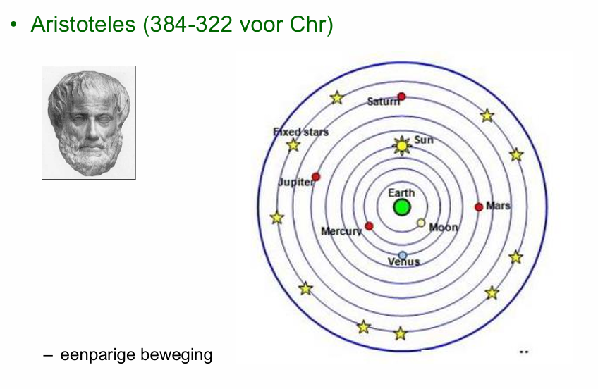
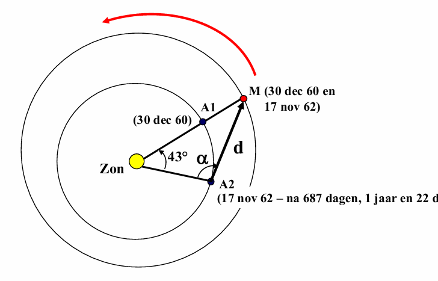
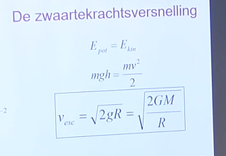

# Zonnestelsel 

- Hoe wist Aristoteles dat Saturnus verder stond van de aarde dan Jupiter? 

## Kepler

### Hoe reconstrueerde Kepler de baan van Mars?

1. Tycho Brahe mat de posities van Mars aan de hemel, onder andere wanneer Mars in oppositie stond. Een oppositie is het moment waarop de aarde tussen de zon en Mars staat.
2. Uit waarnemingen van Mars tegen de achtergrondsterren kon men zijn omlooptijd bepalen: ongeveer 687 dagen. Dat is Mars' jaar; de tijd tussen twee opposities is langer, ongeveer 780 dagen.
3. Neem een waarneming bij oppositie. Na 687 dagen staat Mars, bij benadering, weer in dezelfde richting vanaf de zon. De aarde heeft dan bijna twee omwentelingen gemaakt, maar is nog ongeveer 43 dagen verwijderd van haar oorspronkelijke positie. Als we aannemen dat de aarde gelijkmatig om de zon beweegt, komt dat overeen met ongeveer 42 graden. Zo kunnen we de hoek Aarde-Zon-Mars bepalen.
4. Op dat tweede moment kon Tycho de hoek Zon-Aarde-Mars meten: de schijnbare hoek tussen de zon en Mars aan de hemel.
5. Daarmee kennen we twee hoeken van de driehoek Zon-Aarde-Mars. De derde hoek volgt omdat de hoeken samen 180 graden zijn. Met de afstand Zon-Aarde als basis (1 AE) kunnen we de driehoek oplossen en de afstand Zon-Mars berekenen.
6. Door dit voor verschillende posities van Mars te herhalen, konden Kepler en zijn voorgangers afstanden en posities van Mars' baan reconstrueren. De metingen van Tycho waren daarbij cruciaal.
7. Kepler begon niet met de aanname dat de baan een ellips was. Hij testte modellen tegen de waarnemingen. Een cirkelbaan paste niet nauwkeurig genoeg; uiteindelijk verklaarde een ellips de beweging van Mars veel beter. Dit leidde tot zijn eerste wet.

Deze schets vereenvoudigt Keplers historische berekeningen: voor een nauwkeurige baan waren veel waarnemingen en correcties nodig. De methode beschrijft vooral hoe hij de baan van Mars onderzocht; Keplers tweede en derde wet kwamen uit verdere analyse van de planeetbewegingen.

## Ontsnappings snelheid
